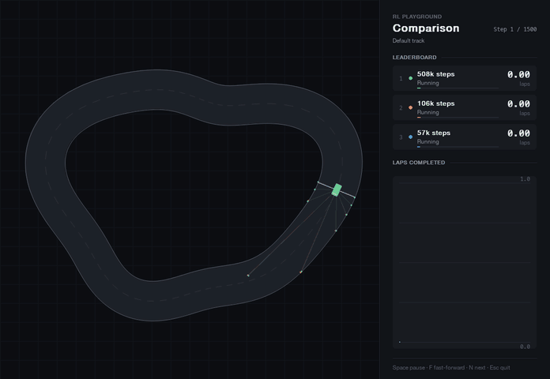
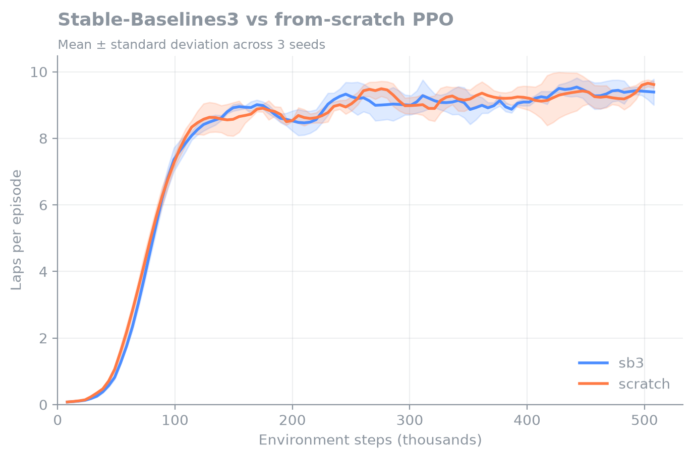
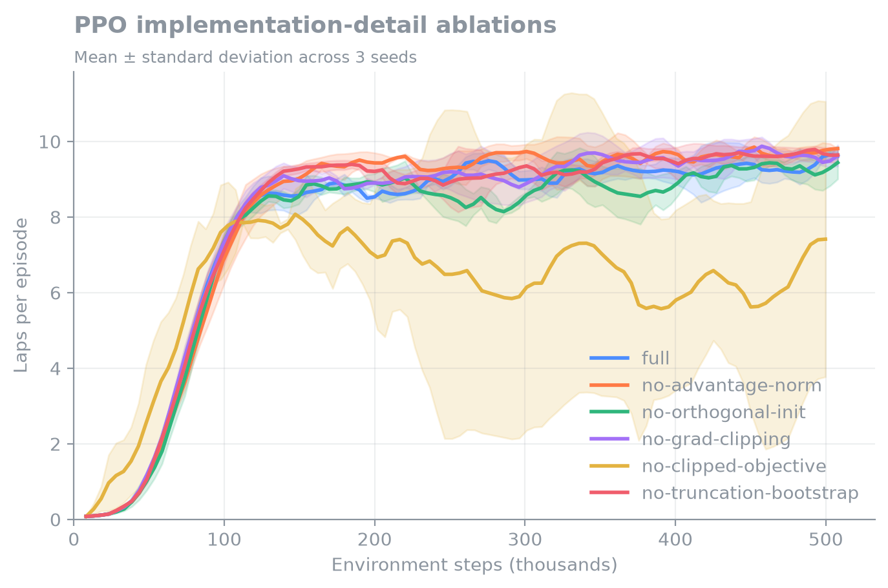
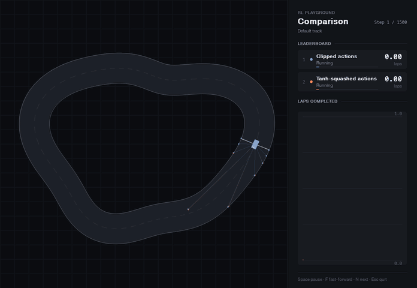
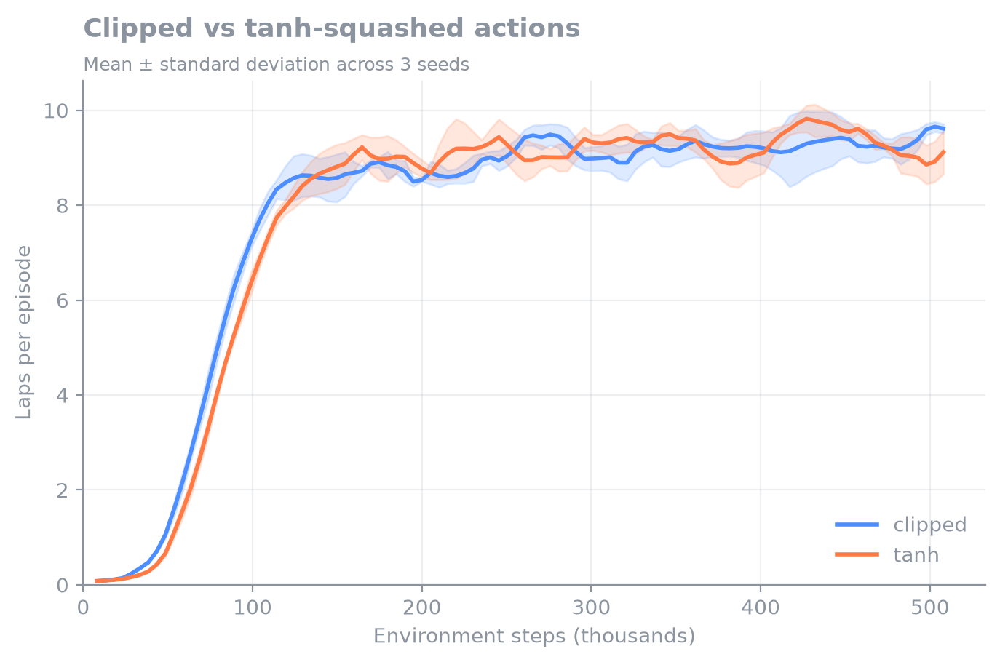

<div align="center">

# RL Playground

**A from-scratch PPO implementation, verified against Stable-Baselines3 and taken apart on a custom racing environment.**

[](https://www.python.org)
[](https://pytorch.org)
[](https://gymnasium.farama.org)
[](https://github.com/astral-sh/ruff)



<sub>The same agent after 57k, 106k and 508k steps of training.</sub>

</div>

## Overview

A car perceives a race track only through nine distance sensors and learns to steer, accelerate and brake from reward
alone. The agent is trained with a self-contained PyTorch implementation of
[Proximal Policy Optimization](https://arxiv.org/abs/1707.06347), which is used to answer three questions:

1. **Is the implementation correct?** It matches Stable-Baselines3 across seeds in learning speed and final performance.
2. **Which implementation details matter?** Removing the clipped objective destabilises training; the other common
   details make little difference on this task.
3. **Why do some trained agents crash when evaluated deterministically?** Clipping out-of-range actions makes the mean
   action unreliable. Squashing actions with tanh fixes it.

All results use three seeds and are reproducible with a single command each.

## Findings

### The implementation matches Stable-Baselines3

Both implementations share every hyperparameter and are trained on the same seeds. Their learning curves are
indistinguishable, and they run at the same speed of about 10,500 environment steps per second on an Apple M3.



| Implementation | Mean training laps | Steps to 5 laps |
| :-- | --: | --: |
| Stable-Baselines3 | 8.07 ± 0.13 | 84k ± 3k |
| From scratch | 8.14 ± 0.10 | 81k |

To match Stable-Baselines3, the implementation reproduces its less visible defaults: separate actor and critic
networks, orthogonal initialisation, a state-independent log standard deviation, per-minibatch advantage
normalisation, gradient-norm clipping and value bootstrapping on time-limit truncation.

### Only the clipped objective is essential here

Each variant removes one implementation detail from the full algorithm.



| Variant | Mean training laps | vs full | Steps to 5 laps | Eval laps | Crash rate |
| :-- | --: | --: | --: | --: | --: |
| full | 8.14 ± 0.10 | – | 81k | 9.59 ± 0.43 | 17% ± 12% |
| no advantage normalisation | 8.40 ± 0.18 | +3% | 90k | 10.16 ± 0.04 | 3% ± 5% |
| no orthogonal initialisation | 7.92 ± 0.11 | −3% | 84k ± 3k | 9.56 ± 0.83 | 13% ± 19% |
| no gradient clipping | 8.30 ± 0.11 | +2% | 84k ± 3k | 10.22 ± 0.02 | 0% ± 0% |
| **no clipped objective** | **6.44 ± 1.94** | **−21%** | 76k ± 7k | **5.24 ± 4.00** | **63% ± 45%** |
| no truncation bootstrap | 8.32 ± 0.05 | +2% | 84k ± 3k | 9.77 ± 0.09 | 3% ± 5% |

<sub>Evaluation samples actions from the policy, over 10 episodes per seed starting at evenly spaced points on the track.</sub>

Without the clipped surrogate objective the agent learns fastest at first, then becomes unstable: policy updates grow
too large and some seeds collapse. This is the mechanism PPO is built around.

The other details change performance by 3% or less, which three seeds cannot reliably separate from noise. This agrees
with large-scale studies such as [Andrychowicz et al. (2021)](https://arxiv.org/abs/2006.05990), which found that many
PPO details matter far less than clipping and core hyperparameters, and that their importance depends on the task.
Truncation bootstrapping has a specific reason to be harmless here: with a discount factor of 0.99 the agent looks
roughly 100 steps ahead, so the time limit at 1,500 steps affects only the last few percent of each episode.

### Tanh squashing fixes brittle deterministic policies

Evaluated with their mean action, two of the three seeds above crash on every episode, at the same corner, about one
lap in. Sampling actions instead, the same agents complete 90% of episodes.



The cause is how out-of-range actions are handled. The policy samples from a Gaussian and the sample is clipped to
[−1, 1], so PPO optimises the return of clipped, noisy actions. A mean beyond the bounds receives no learning signal of
its own and drifts to values that only work because noise pulls the executed action back. At the track's tightest
corner, which leaves 9 pixels of margin at full speed, the raw mean is enough to hit the wall.

Squashing samples through tanh keeps every action in bounds by construction, with the change-of-variables correction
applied to the log-probability, so every change in the mean changes the action.

| Actions | Deterministic eval laps | Deterministic crash rate | Sampled crash rate | Mean training laps |
| :-- | --: | --: | --: | --: |
| Clipped | 4.08 ± 4.41 | 67% ± 47% | 17% ± 12% | 8.14 ± 0.10 |
| Tanh-squashed | **10.28 ± 0.03** | **0% ± 0%** | **0% ± 0%** | 8.07 ± 0.03 |



The learning curves are almost identical, which is the important caveat: training metrics alone never reveal the
problem. It only appears when the policy is evaluated without noise.

### The agents discover a racing line

A car driving the centerline at top speed for a full episode would complete 9.37 laps. Trained agents complete about
10.3. They cut to the inside of corners and cover less distance per lap, a behaviour that emerges from the progress
reward without being specified.

## Reproducing the results

Requires Python 3.11+ and [uv](https://docs.astral.sh/uv/).

```bash
git clone https://github.com/xquantize/rl-playground.git
cd rl-playground
uv sync

uv run rlp experiment run sb3-vs-scratch       # each experiment trains every variant on three seeds
uv run rlp experiment report sb3-vs-scratch    # evaluates the models and writes results/sb3-vs-scratch/
uv run rlp experiment plot sb3-vs-scratch      # draws media/sb3-vs-scratch.png
```

The same three commands work for `ppo-ablations` and `action-squashing`. Add `--stochastic` to `report` to evaluate
with sampled actions. Interrupted experiments resume where they stopped. Each report writes a markdown table, per-seed
results as JSON and mean learning curves as CSV to [`results/`](results).

## Usage

```bash
uv run rlp train --name my-agent --algorithm scratch --seeds 0 1 2   # train; --algorithm sb3 for Stable-Baselines3
uv run rlp evaluate runs/my-agent --episodes 20                      # mean ± std across seeds
uv run rlp watch runs/my-agent                                       # live sensor, action and reward telemetry
uv run rlp compare runs/a runs/b --track random                      # race agents on an unseen random track
uv run rlp drive                                                     # drive the car yourself
```

Training curves, including lap count and crash rate, are logged to TensorBoard with `uv run tensorboard --logdir runs`.

## Environment

The racing environment is registered with Gymnasium as `rl_playground/Racing-v0`.

```python
import gymnasium as gym
import rl_playground.envs

env = gym.make("rl_playground/Racing-v0", track_mode="random", render_mode="human")
```

| Component | Specification |
| :-- | :-- |
| Observation | 12 values: nine sensor distances across a 180° field of view, speed, and heading relative to the track |
| Action | Steering and throttle, each in [−1, 1]; negative throttle brakes |
| Reward | +100 per lap of progress, −0.01 per step, −10 for leaving the track |
| Termination | Leaving the track |
| Truncation | 1,500 steps, or 150 consecutive steps without progress |

Random tracks are generated by perturbing a circle with low-frequency harmonics, rejecting layouts whose corners are
too tight for the track width.

## Development

```bash
uv run pytest
uv run ruff check .
uv run ruff format .
```

## License

[MIT](LICENSE)
